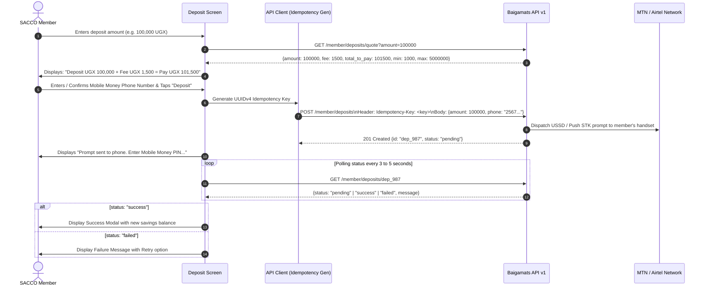
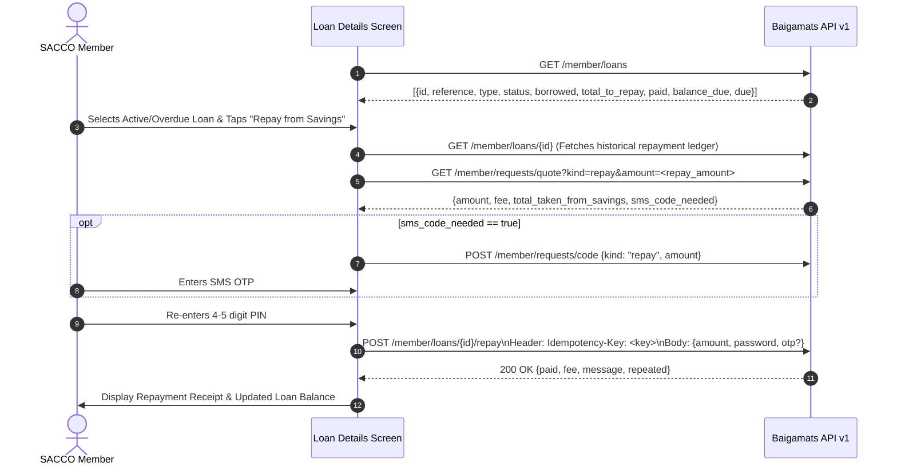
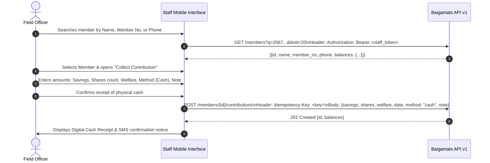

# Baigamats Mobile App: Implementation Plan & Technical Architecture

> **Document Version:** 1.0.0  
> **Source Documents:** `docs/Baigamats_Mobile_App_Brief_v2.docx` (Version 2, 25 October 2026) and `docs/api-docs.json` (OpenAPI v1.2.0)  
> **Target Framework:** React Native bare workflow, TypeScript, NativeWind, Zustand, TanStack Query, React Native Keychain  

---

## 1. Executive Overview & Core Requirements

This implementation plan specifies the complete end-to-end architecture and phased rollout for the **Baigamats Mobile Application**. The app provides a dedicated mobile client for SACCO / Cooperative members, field officers, and business operations.

### Key Tenets
1. **Zero Explicit Tenant Identification:** Member calls rely entirely on `Authorization: Bearer bmm_...` tokens. The server automatically infers the member and their cooperative organization. The app never exposes or submits manual business or member identifiers to select target data.
2. **Strict Financial Idempotency:** Every API mutation that impacts funds (`deposit`, `withdrawal`, `transfer`, `repayment`, `staff contribution`) requires a client-generated `Idempotency-Key` (8-64 ASCII characters). The key is retained across automatic retries or network recovery to prevent duplicate transactions.
3. **Currency Precision:** All monetary amounts are whole Ugandan Shillings (`UGX`) handled as numbers, rendered with thousand separators (e.g., `50,000 UGX`) both in static text and dynamically during input.
4. **Resilient Session Management:** 15-minute access token lifespan with 7-day refresh token rotation. Immediate enforcement of `409 session_active` (single active device), `403 account_locked` (5 incorrect PIN attempts), and `403 password_change_required` (temporary PIN).

---

## 2. Global Standards & Protocol Rules

### 2.1 Networking & API Specifications
- **Base URL:** `https://business.baigamats.com/api/v1`
- **Standard Request Headers:**
  - `Content-Type: application/json`
  - `Accept: application/json`
  - `Authorization: Bearer <access_token>` (for authenticated member/staff calls)
  - `X-App-Version: <platform>/<semver>` (e.g. `android/1.0.0` or `ios/1.0.0`). Mandatory on every call.
  - `Idempotency-Key: <key>` (8 to 64 chars matching `^[a-zA-Z0-9_\-\.:]{8,64}$` for money operations).
- **Pagination Shape:**
  ```json
  {
    "data": [ ... ],
    "total": 120,
    "limit": 20,
    "offset": 0
  }
  ```
- **Standard Error Format:**
  ```json
  {
    "error": {
      "code": "invalid_request",
      "message": "Human readable explanation"
    }
  }
  ```
- **Rate Limit Policy:** 120 calls per minute per member. HTTP `429 rate_limited` triggers exponential backoff with jitter.

### 2.2 HTTP Status & Error Handling Matrix

| HTTP Status | Error Code | Client Handling Action |
| :--- | :--- | :--- |
| `400` | `invalid_request`, `idempotency_key_required` | Validate request payload and ensure unique header is supplied. |
| `401` | `unauthorized`, `token_expired`, `session_ended` | Trigger refresh token flow; if refresh fails or is expired, clear secure store and redirect to login. |
| `401` | `confirmation_failed` | Prompt the user that their PIN or SMS OTP was incorrect. Allow retry without resetting input form. |
| `403` | `password_change_required` | Intercept navigation and force user to `/auth/change-password` before any account access. |
| `403` | `account_locked` | 5 wrong PIN attempts. Block login form; instruct user to visit physical cooperative branch. |
| `403` | `module_disabled` | Cooperative disabled this feature. Show user-friendly disabled notice and disable feature card. |
| `409` | `session_active` | Member logged in on another device. Advise user to log out on other device or wait for idle timeout. |
| `422` | `insufficient_funds`, `weak_password` | Display server error message in contextual field or inline alert banner. |
| `426` | `upgrade_required` | Intercept response and render non-dismissible screen directing user to Google Play / App Store. |
| `429` | `rate_limited` | Retry after `Retry-After` header or exponential delay. |

---

## 3. Module Scope & Contract Analysis

### Module 1: Member Authentication & Security
- **Endpoints:**
  - `POST /member/auth/login`: `{ org, member_no, password, device_id? }` $\rightarrow$ `{ session, must_change_password, member, organization }`
  - `POST /member/auth/refresh`: `{ refresh_token }` $\rightarrow$ `{ session: { access_token, refresh_token, expires_in } }`
  - `POST /member/auth/logout`: `{}` $\rightarrow$ `{ ok: true }`
  - `POST /member/auth/change-password`: `{ current?, next }` $\rightarrow$ `{ ok: true }`
- **Key Rules:** 
  - Password is a 4 or 5 digit PIN.
  - Refresh tokens are one-time use; discarding the old token and storing the new rotated token in Keychain is mandatory.

### Module 2: Member Account & Transaction Statement
- **Endpoints:**
  - `GET /member/me` $\rightarrow$ Personal info & balances (`savings`, `shares_value`, `shares_count`, `share_price`, `welfare_paid_in`, `welfare_received`, `welfare_net`, `share_interest`, `pending_withdrawals`, `fees_paid`).
  - `GET /member/transactions?limit=&offset=&from=&to=` $\rightarrow$ Paginated statement rows (`id`, `type`, `label`, `direction: in | out`, `amount`, `fee`, `shares`, `status: completed | pending | rejected | reversed`, `date`, `note`).
- **Key Rules:** Filterable by date range (`YYYY-MM-DD`). Cached for offline inspection via TanStack Query.

### Module 3: Mobile Money Deposit
- **Endpoints:**
  - `GET /member/deposits/quote?amount=` $\rightarrow$ `{ amount, fee, total_to_pay, min_deposit, max_deposit }`
  - `POST /member/deposits` (Header: `Idempotency-Key`): `{ amount, phone }` $\rightarrow$ `{ id, status: "pending" }`
  - `GET /member/deposits/{id}` $\rightarrow$ `{ status: "pending" | "success" | "failed", message }`
- **Key Rules:** Member pays deposit fee on top of savings amount (`total_to_pay = amount + fee`). Polled every 3-5s until terminal state.

### Module 4: Saved Withdrawal Numbers (Beneficiaries)
- **Endpoints:**
  - `GET /member/beneficiaries` $\rightarrow$ Array of `{ id, label, phone_masked, usable, usable_from }`
  - `POST /member/beneficiaries/code` $\rightarrow$ Dispatches 6-digit SMS OTP to member's registered SIM.
  - `POST /member/beneficiaries`: `{ phone, label?, otp }` $\rightarrow$ `201 Created`
  - `DELETE /member/beneficiaries/{id}` $\rightarrow$ `{ ok: true }`
- **Key Rules:** Max 3 saved numbers. Newly added numbers have a 24-hour security cooldown (`usable: false`, `usable_from: <iso-timestamp>`).

### Module 5: Money Requests & Internal Transfers
- **Unified Types:**
  1. `withdraw`: Payout to verified beneficiary phone.
  2. `to_member`: Internal P2P transfer to another cooperative member number.
  3. `to_shares`: Purchase additional cooperative shares using available savings.
  4. `to_welfare`: Pay welfare fund contribution using available savings.
- **Endpoints:**
  - `GET /member/requests/quote?kind=&amount=` $\rightarrow$ `{ amount, fee, total_taken_from_savings, sms_code_needed }`
  - `POST /member/requests/code`: `{ kind, amount? }` $\rightarrow$ Dispatches SMS OTP when required.
  - `POST /member/requests` (Header: `Idempotency-Key`): `{ kind, password, amount, beneficiary_id?, member_no?, note?, otp? }` $\rightarrow$ `{ id, status: "approved" | "waiting_for_approval" }`
  - `GET /member/requests/{id}` $\rightarrow$ `{ status: "waiting_for_approval" | "completed" | "rejected" | "reversed", amount, fee, date }`
- **Key Rules:** Password must be re-entered by the user for every money request; never persist this password in memory or storage.

### Module 6: Loans & Repayments
- **Endpoints:**
  - `GET /member/loans` $\rightarrow$ Array of `{ id, reference, type, status: "active" | "overdue" | "closed", borrowed, total_to_repay, paid, late_fees, balance_due, issued, due }`
  - `GET /member/loans/{id}` $\rightarrow$ Detailed schedule & repayments array (`date`, `amount`, `method`, `balance_after`).
  - `POST /member/loans/{id}/repay` (Header: `Idempotency-Key`): `{ amount, password, otp? }` $\rightarrow$ `{ paid, fee, message, repeated }`
- **Key Rules:** Repayments are deducted from available savings. Quote and OTP verification use `/member/requests/quote?kind=repay` and `/member/requests/code` with `kind: "repay"`.

### Module 7: Field Staff Operations
- **Authentication:** Uses staff login with business permissions (`members:read`, `members:write`).
- **Endpoints:**
  - `GET /members?q=&limit=&offset=` $\rightarrow$ Search members by name, member number, or phone.
  - `GET /members/{id}` $\rightarrow$ Single member profile & balance sheet.
  - `GET /members/{id}/transactions` $\rightarrow$ Member statement.
  - `POST /members/{id}/contributions` (Header: `Idempotency-Key`): `{ savings?, shares?, welfare?, date, method, note? }` $\rightarrow$ Records physical counter collections.

### Module 8: Merchant & Business Platform Extensions (api-docs.json)
- **Endpoints:**
  - Invoicing & Digital Collections: `/invoices`, `/invoices/{id}/collect`, `/collections`
  - Point of Sale / Shop & Inventory: `/shop`, `/products`, `/inventory`, `/sales`, `/orders`
  - Utility & Airtime Bill Payments: `/bills/services`, `/bills/validate`, `/bills/pay`, `/airtime`

---

## 4. Phase-by-Phase Implementation Roadmap

### Phase 1: Core Foundation & Member Authentication
- **Objective:** Upgrade API client to support `X-App-Version`, idempotency headers, error code parsing, and secure member auth store.
- **Deliverables:**
  1. Add `memberAuthApi` with endpoints: `/member/auth/login`, `/member/auth/refresh`, `/member/auth/logout`, `/member/auth/change-password`.
  2. Implement `X-App-Version` injection interceptor and modal handler for `426 upgrade_required`.
  3. Create UUID-based `Idempotency-Key` generator and Axios interceptor for payment calls.
  4. Build Member Login Screen supporting `org`, `member_no`, and 4-5 digit PIN.
  5. Build Force Change PIN screen handling `must_change_password` and `403 password_change_required`.
  6. Handle `409 session_active` and `403 account_locked` edge-case dialogs.
  7. Unit tests for token rotation, storage hydration, and interceptor behaviors.

### Phase 2: Member Account & Statement Engine
- **Objective:** Display the member's financial overview and detailed transaction statements.
- **Deliverables:**
  1. Add `memberAccountApi` (`GET /member/me`, `GET /member/transactions`).
  2. Build Home / Dashboard Screen with modular cards:
     - Savings Balance card with quick action buttons (Deposit, Withdraw, Transfer).
     - Share Capital card (shares count, share price, total valuation, dividend interest).
     - Welfare Fund card (paid in, received, net).
  3. Build Statements Screen with infinite scroll pagination (`limit`, `offset`) and date filter modal (`from`, `to`).
  4. Real-time UGX formatting component with localization.
  5. Pull-to-refresh and TanStack Query caching for offline viewing.

### Phase 3: Mobile Money Deposit Flow
- **Objective:** Enable seamless mobile money deposits via MTN / Airtel push prompts.
- **Deliverables:**
  1. Add `depositsApi` (`GET /member/deposits/quote`, `POST /member/deposits`, `GET /member/deposits/{id}`).
  2. Build Deposit Screen:
     - Real-time quote preview: user inputs amount $\rightarrow$ displays fee and total payable.
     - Phone number selector (registered number or alternative phone).
  3. Polling state machine hook (`useDepositPolling`): polls every 3-5 seconds with timeout and retry controls.
  4. Deposit Result Modal with clear status indications (Pending $\rightarrow$ Success / Failed).

### Phase 4: Beneficiaries & Unified Transfer Engine
- **Objective:** Manage withdrawal beneficiaries and power the 4 transfer pathways (`withdraw`, `to_member`, `to_shares`, `to_welfare`).
- **Deliverables:**
  1. Add `beneficiariesApi` and `requestsApi`.
  2. Build Beneficiaries Screen:
     - List up to 3 numbers with masked phones and status tags.
     - 24-hour security cooldown badge with active countdown.
     - Add Beneficiary Modal with SMS OTP verification flow.
  3. Build Unified Request / Transfer Screen:
     - Tabs or selector for the 4 transfer types.
     - Dynamic fee quote calculation.
     - SMS OTP modal (triggered when `sms_code_needed` is true).
     - PIN confirmation bottom sheet (password re-prompt on every money movement).
  4. Request status tracking (Instant `approved` vs. Staff `waiting_for_approval`).

### Phase 5: Loans Portfolio & In-App Repayment
- **Objective:** Comprehensive loan management and savings-based loan repayments.
- **Deliverables:**
  1. Add `loansApi` (`GET /member/loans`, `GET /member/loans/{id}`, `POST /member/loans/{id}/repay`).
  2. Build Loans Screen with status segmentation (Active, Overdue, Closed).
  3. Build Loan Details Screen showing repayment schedule, accrued interest, and penalty fees.
  4. Build Loan Repay Modal:
     - Pre-fills available savings balance.
     - Fetches fee quote and SMS OTP via `/member/requests/quote?kind=repay`.
     - Prompts for PIN and dispatches repayment with idempotency protection.

### Phase 6: Field Staff Operations & Platform Extensions
- **Objective:** Field agent counter-contribution tools and utility integrations from `api-docs.json`.
- **Deliverables:**
  1. Staff role switcher and permission-based navigation guards (`members:read`, `members:write`).
  2. Field Officer Member Directory with live search (`name`, `member_no`, `phone`).
  3. Counter Contribution Form to record cash payments (savings, shares count, welfare) with idempotency keys.
  4. Merchant & Utility integrations:
     - Airtime & utility bill payments (`/bills/services`, `/bills/pay`, `/airtime`).
     - Invoicing and digital collections (`/invoices`, `/collections`).

---

## 5. Architectural Sequence Flow Diagrams

### 5.1 Member Authentication & Security Lifecycle
```mermaid
sequenceDiagram
    autonumber
    actor Member as SACCO Member
    participant App as Mobile App
    participant Sec as Secure Keychain Store
    participant Server as Baigamats API v1

    Member->>App: Submits Org Slug, Member No / Phone, 4-5 digit PIN
    App->>Server: POST /member/auth/login\nHeaders: X-App-Version, Content-Type: application/json\nBody: {org, member_no, password, device_id}

    alt 426 upgrade_required
        Server-->>App: 426 Upgrade Required {message}
        App->>Member: Display Forced Store Update Dialog (Redirect to App Store / Play Store)
    else 409 session_active
        Server-->>App: 409 Conflict {message}
        App->>Member: Display "Active session exists on another device. Please logout first."
    else 403 account_locked
        Server-->>App: 403 Forbidden {code: "account_locked"}
        App->>Member: Display "Account locked after 5 wrong attempts. Visit your branch."
    else 200 OK (must_change_password: true)
        Server-->>App: 200 OK {session, must_change_password: true}
        App->>Sec: Persist session tokens (bmm_...)
        App->>Member: Route immediately to Change PIN Screen
        Member->>App: Enters new 4-5 digit PIN
        App->>Server: POST /member/auth/change-password {next: "..."}
        Server-->>App: 200 OK {ok: true}
        App->>Member: Route to Main Member Dashboard
    else 200 OK (Standard)
        Server-->>App: 200 OK {session, member, organization}
        App->>Sec: Persist access_token & refresh_token in Keychain
        App->>Member: Route to Main Member Dashboard
    end

    Note over App,Server: Automatic Interceptor Token Refresh
    App->>Server: Any Member Endpoint Call (e.g. GET /member/me)
    Server-->>App: 401 Unauthorized {code: "token_expired"}
    App->>Server: POST /member/auth/refresh {refresh_token: "<stored_refresh>"}
    alt Refresh Success
        Server-->>App: 200 OK {session: {access_token, refresh_token, expires_in}}
        App->>Sec: Store newly rotated tokens; discard old
        App->>Server: Replay original request with new access token
    else Refresh Failed
        Server-->>App: 401 Unauthorized
        App->>Sec: Clear stored tokens
        App->>Member: Redirect to Login Screen
    end
```

---

### 5.2 Mobile Money Deposit Flow


---

### 5.3 Unified Money Requests & Transfers Flow
```mermaid
sequenceDiagram
    autonumber
    actor Member as SACCO Member
    participant UI as Transfer/Request Modal
    participant Client as API Client
    participant Server as Baigamats API v1

    Member->>UI: Selects Kind (withdraw | to_member | to_shares | to_welfare) & Amount
    UI->>Server: GET /member/requests/quote?kind=<kind>&amount=<amt>
    Server-->>UI: {amount, fee, total_taken_from_savings, sms_code_needed}
    UI->>Member: Displays deduction breakdown (Principal + Fee deducted from savings)

    opt sms_code_needed == true
        UI->>Server: POST /member/requests/code {kind, amount}
        Server-->>UI: 200 OK (6-digit code sent by SMS)
        Member->>UI: Inputs 6-digit SMS OTP
    end

    UI->>Member: Prompts for 4-5 digit PIN (Mandatory re-verification)
    Member->>UI: Enters PIN
    UI->>Client: Generate unique Idempotency-Key
    Client->>Server: POST /member/requests\nHeader: Idempotency-Key: <key>\nBody: {kind, password, amount, otp?, beneficiary_id?, member_no?, note?}

    alt 401 confirmation_failed
        Server-->>UI: 401 confirmation_failed (Wrong PIN or SMS OTP)
        UI->>Member: Display error message; allow retry without clearing form
    else 201 status: "approved"
        Server-->>UI: 201 Created {id, status: "approved"}
        UI->>Member: Instant Success Screen (Balances updated)
    else 201 status: "waiting_for_approval"
        Server-->>UI: 201 Created {id, status: "waiting_for_approval"}
        UI->>Member: Display "Submitted for SACCO Staff Approval"
        loop Periodic Poll or Pull-to-refresh
            UI->>Server: GET /member/requests/{id}
            Server-->>UI: {status: "completed" | "rejected"}
        end
    end
```

---

### 5.4 Loan Portfolio & In-App Savings Repayment


---

### 5.5 Field Staff Cash Contribution Flow


---

## 6. Verification, Security & Testing Strategy

1. **Idempotency Failure Recovery Test:**
   - Trigger a money movement request.
   - Intercept and abort the client connection prior to response reception.
   - Re-send the identical request with the same `Idempotency-Key`.
   - Assert that the server returns the cached response with no secondary debit.
2. **Brute Force Lockout Test:**
   - Attempt 5 incorrect PIN submissions sequentially.
   - Assert server returns `403 account_locked`.
   - Ensure the UI locks the login form and displays the cooperative branch resolution message.
3. **App Version Gate Test:**
   - Send `X-App-Version: android/0.0.1`.
   - Assert server returns `426 upgrade_required`.
   - Verify non-dismissible Update Screen blocks navigation.
4. **Number Input Masking & Separation:**
   - Test UGX input formatting across edge amounts (`0`, `500`, `1000000`, `99999999`).
   - Validate live thousand-separator injection while maintaining numeric state.

